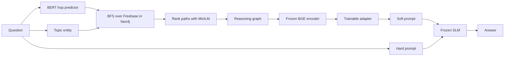

# Generalised Transformer-based Knowledge Adapter for Small LLMs

A **Retrieve-Embed-Reason** framework, inspired by LightPROF, that helps small language models (SLMs) answer questions using a knowledge graph. Relevant facts are retrieved from **Freebase**, encoded into compact soft prompts by a trainable adapter, and passed to a frozen SLM. The framework is evaluated on the **WebQSP** benchmark.

Built for the Advanced NLP course at IIIT Hyderabad (2025). The full method and analysis are in the [project report](report.pdf).

## Key Findings

- **Best adapter:** Granite-4.0-h-1B reached a ROUGE-1 recall of **0.5289** and ROUGE-L recall of **0.5265** with fixed 2-hop context.
- **Direct inference still won:** passing the reasoning graph to the SLM as plain text scored higher than the trained adapters across all models.
- **Hop prediction:** a BERT classifier with a linear head predicted the hop count with **94.00%** test accuracy.
- **Fixed 2-hop retrieval is a viable baseline:** it often matched or beat expected-hop context, suggesting the hop predictor may not be required.
- **Neo4j was the most practical graph backend** among flat-file search, SQLite, graph libraries, and Neo4j.

## Pipeline



1. **Hop prediction:** fine-tune `bert-base-uncased` to predict the number of hops, comparing linear, MLP, and regression heads.
2. **Retrieval and ranking:** traverse Freebase from the topic entity with BFS, then rank paths against the question using `all-MiniLM-L6-v2`.
3. **Adapter training:** encode the reasoning graph with `BAAI/bge-base-en-v1.5` and project it through a two-layer MLP. Only the adapter is trained.
4. **Inference:** combine the soft prompt with a hard prompt and generate an answer with the SLM.

Models evaluated: **Qwen3** (0.6B, 1.7B, 4B), **Llama 3.2 1B**, and **Granite-4.0-h-1B**.

## Data

| Source | Role | Details |
| --- | --- | --- |
| **Freebase** (`freebase-easy-14-04-14`) | Knowledge graph | 18.9 GB uncompressed, about 242M fact lines |
| **WebQSP** | Question answering benchmark | 4,737 questions with topic entities, inferential chains, and answers |

The Freebase snapshot contains three files:

- `facts.txt`: the knowledge graph triples.
- `scores.txt`: a confidence score for each fact.
- `freebase-links.txt`: mappings from machine IDs to human-readable names and URLs.

> **Note:** All results in this repository were produced on this exact snapshot, `freebase-easy-14-04-14`. Retrieval coverage and downstream scores may differ on other Freebase versions.

## Results

### Hop prediction

Evaluated on the 1,616-question WebQSP test set.

| BERT head | Accuracy | Macro-F1 |
| --- | ---: | ---: |
| **Linear** | **0.9400** | **0.9346** |
| MLP* | 0.9363 | 0.9308 |
| Regression* | 0.9313 | 0.9249 |

\* These rows were re-evaluated from the saved weights and differ from the report. The report's MLP score (0.4870 accuracy, 0.4811 F1) came from a reload step that discarded the trained MLP head. Its regression score (0.9115 accuracy, 0.9042 F1) was measured on a 305-question validation split.

### Retrieval and ranking

Share of the 2,950 training questions with a gold answer in the selected paths.

| Selection | Accuracy | Hits |
| --- | ---: | ---: |
| Top-5 | 0.5098 | 1,504 |
| **Top-10 (selected)** | **0.5464** | **1,612** |
| Top-30 | 0.5498 | 1,622 |
| Top-p 0.1 | 0.4606 | 1,359 |
| Top-p 0.2 | 0.5013 | 1,479 |
| Top-p 0.3 | 0.5267 | 1,554 |
| Top-p 0.5 | 0.5569 | 1,643 |

Top-10 was selected because Top-30 adds little coverage for three times as many paths, and Top-p 0.5 averages 83 paths per question. Even with 2-hop graphs, only 1,681 of the 2,950 questions had a reachable answer.

### Answer generation

Recall scores for trained adapters and direct inference, under expected-hop and fixed 2-hop context.

**ROUGE-1**

| Model | Adapter, expected hops | Adapter, 2 hops | Direct, expected hops | Direct, 2 hops |
| --- | ---: | ---: | ---: | ---: |
| Qwen3 0.6B | 0.3425 | 0.3432 | 0.8567 | 0.8429 |
| Qwen3 1.7B | 0.3933 | 0.4185 | 0.8189 | 0.8208 |
| Qwen3 4B | 0.4497 | 0.5238 | 0.9112 | 0.8969 |
| Llama 3.2 1B | 0.4539 | 0.2582 | 0.7823 | 0.7796 |
| **Granite 4.0 1B** | 0.4489 | **0.5289** | 0.8231 | 0.8267 |

**ROUGE-L**

| Model | Adapter, expected hops | Adapter, 2 hops | Direct, expected hops | Direct, 2 hops |
| --- | ---: | ---: | ---: | ---: |
| Qwen3 0.6B | 0.3408 | 0.3405 | 0.8533 | 0.8351 |
| Qwen3 1.7B | 0.3920 | 0.4157 | 0.8103 | 0.8151 |
| Qwen3 4B | 0.4465 | 0.5213 | 0.9022 | 0.8950 |
| Llama 3.2 1B | 0.4522 | 0.2562 | 0.7605 | 0.7675 |
| **Granite 4.0 1B** | 0.4473 | **0.5265** | 0.8134 | 0.8208 |

Recall rewards long outputs that happen to contain the answer, so these scores do not measure exact-answer accuracy. In the saved Llama and Granite notebooks, direct inference is scored against the best-matching gold answer, while the adapter is scored against the first gold answer, so the gap between them should be read with care.

## Repository Structure

| File | Purpose |
| --- | --- |
| `report.pdf` | Full project report |
| `hop_prediction_bert_linear.py` | Hop prediction with a linear classification head |
| `hop_prediction_bert_mlp.py` | Hop prediction with an MLP classification head |
| `hop_prediction_bert_regression.py` | Hop prediction with a regression head |
| `retrievel_methods_exploration.ipynb` | Flat-file, SQLite, NetworkX, and early Neo4j retrieval |
| `preprocess_networkx.py` | NetworkX graph construction from Freebase |
| `neo4j_creation_dataset_builder.ipynb` | Neo4j import, path retrieval, ranking, and dataset building |
| `knowledge_adaptor.ipynb` | Adapter training, inference, and evaluation |
| `simple_inference_with_LLM.ipynb` | Direct inference with SLMs |

**Model weights, trained adapters, and datasets** are linked in Section 7 ("Code and Model links") of the [project report](report.pdf).

## Getting Started

```bash
pip install torch transformers sentence-transformers scikit-learn pandas numpy \
    neo4j networkx tqdm nltk rouge_score evaluate huggingface_hub
```

You will need a GPU, a running [Neo4j](https://neo4j.com/) instance, enough disk space for Freebase, and Hugging Face access for gated models such as Llama.

Suggested order:

1. Train a hop predictor, for example `python hop_prediction_bert_linear.py`.
2. Build the graph and retrieve paths with `neo4j_creation_dataset_builder.ipynb`.
3. Run direct inference with `simple_inference_with_LLM.ipynb`.
4. Train and evaluate the adapter with `knowledge_adaptor.ipynb`.

File paths, model names, and connection settings are set near the top of each script or notebook. Update them for your environment before running.

## Limitations

- Retrieval uses WebQSP's annotated topic entities, so entity recognition is not part of the evaluated pipeline.
- Many gold answers are missing from the retrieved graphs, which the report attributes to a mismatch between the Freebase snapshot used here and the one WebQSP was built on.
- The adapter can hallucinate or continue generating past the answer, as shown in the report's negative examples.
- `hop_prediction_bert_mlp.py` must load its best checkpoint with `BertWithMLPHead` to evaluate the trained head correctly.

## References

- Ao et al., *LightPROF: A Lightweight Reasoning Framework for Large Language Model on Knowledge Graph*, AAAI 2025.
- Yih et al., *The Value of Semantic Parse Labeling for Knowledge Base Question Answering*, ACL 2016.
- Bollacker et al., *Freebase: A Collaboratively Created Graph Database for Structuring Human Knowledge*, SIGMOD 2008.

## Authors

- **Sakhil Taneja** ([@tanejasakhil](https://github.com/tanejasakhil))
- **Kallind Soni** ([@Kallind](https://github.com/Kallind))
